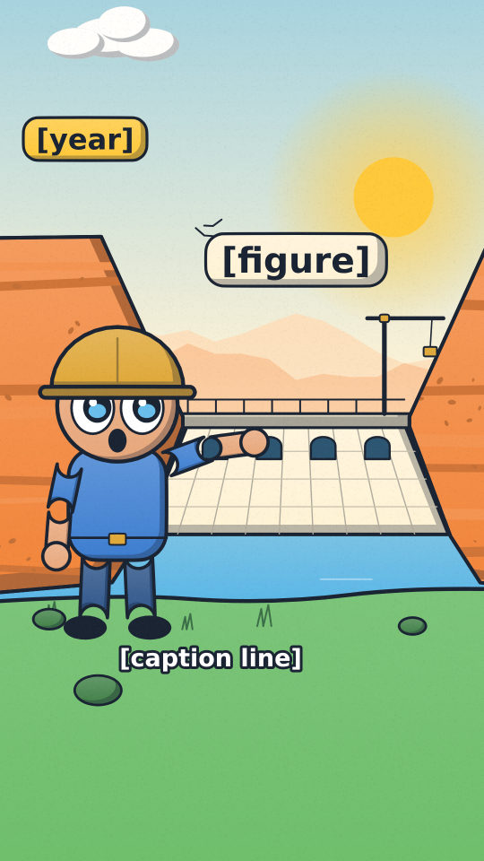

# Cartoon Style GoDocs style

Infographic documentary with web-cartoon characters. Cel-shaded vector shapes, bold outlines at one weight, mood palettes that change with the scene, layered backgrounds with vector icons, a puppet-rig narrator. Not anime and not a children's cartoon. Made for history explainers in 9:16 and 16:9.

## Palette

`GC_MOODS` in `kit.js`. Set the mood with `gcMood('sunny' | 'neutral' | 'disaster')`. Change it only across a bridge, never inside a scene. Hex values are starting values from the look check.

| Mood | Used for | Colors |
|---|---|---|
| Sunny | Build-up, success, hook | sun FFC93C, orange F2853A, sky 4FB3E8, grass 5DB75A, cream FFF3D6, ink 1B2433 |
| Neutral | Context, today, close | cream F4EBD8, slate 3F5C7A, olive 7A8A3C, brick B5472E, mustard E0A93B, ink 1B2433 |
| Disaster | Cost, failure, flood | mist 9AA3AB, slate 5B6770, storm 3A444D, mud 7B6F5E, flood water 6F8794, rust A9503A, ink 161B22 |

The hero's colors never change with the mood: hat E0A93B, skin E8A87C, stake wood B98A52.

## The medium

- `gcShape(P, fill, o)`: fill, a hard shadow on the lower right, a soft top gradient, a bold outline. Outline weight is the same everywhere and constant on screen at any zoom (`gcLW`).
- `gcFill`: gradient fill with no outline, for distant layers.
- Backgrounds: `gcSky`, `gcRidge` (haze by depth), `gcRock` (strata and speckle), `gcRiver`, `gcDam`, `gcPylon`, `gcCrane`, `gcHaze`.
- Props: `gcBus`, `gcTurbine`, `gcMapCard` (a route that draws on).
- Text: `gcText`, `gcLabel` (a plate that pops in on a cue), `gcTag` and `gcCaption` (screen size, through DEFER).
- `post()` lays a static seeded grain over every frame.

## The Surveyor

`gcSurveyor(x, y, h, { face, pose, flip, stake, look, key })`. (x, y) is the feet.
- Faces: neutral, surprise, worry, delight, deadpan. Map them to beats: surprise on the hook, worry on a failure, deadpan on the cost, delight on a success.
- Poses: idle, hold, point, wow, worry, shrug.
- Idle motion: bob, arm sway, blink.
- Faces appear on characters only. Never on objects, buildings or machines.
- Original character. Never copy a source or known mascot.

## Motion habits

- On 1s (`ones: true`) with spring settles. Export with `--blur 4` if the motion looks stepped.
- Every scene moves: a slow push-in or pan from `pieceCam`. A text card may hold still.
- Infographics pop in on a cue word with `popS`.
- Scale gags: draw both objects at the same scale, label both sizes, and source the familiar object's size.

## Frame checklist (on top of grammar/FRAME.md)

- Eyes read at phone size.
- Outline weight is constant.
- The mood palette matches the scene and the frame holds at most 6 palette colors plus ink.
- One focal element. The eye lands on the hero or the figure.
- Text stays inside the safe area in 9:16 and in 16:9.
- Faces appear on characters only.
- Nothing matches a source character, source frame or known mascot.
- Keep the caption band (y 1400 to 1500 in 9:16) clear of characters.

## Do and do not

- Do give every number scene a scale gag and a sourced size.
- Do keep one hero accent per frame.
- Do not mix mood palettes inside a scene.
- Do not use real-person likenesses. Name a historical person on a label only with a fact flag.

## Not matched

- Backgrounds are clean vector landscapes. They are not semi-realistic matte paintings. Fallback: background images in the piece's assets/, with characters, icons and text kept vector on top.
- Arms are capsule shapes. Poses are simple.
- No mouth sync yet. Planned: open the mouth between each spoken word's start and end from voice.json.

## Proven on

- The look check in `demo/`: four hard-cut frames (a dam in sunny and disaster moods, a scale gag, a map). It has no morph bridge and has not carried a full piece. Treat the style as new ground.
